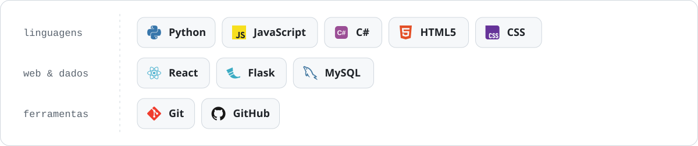
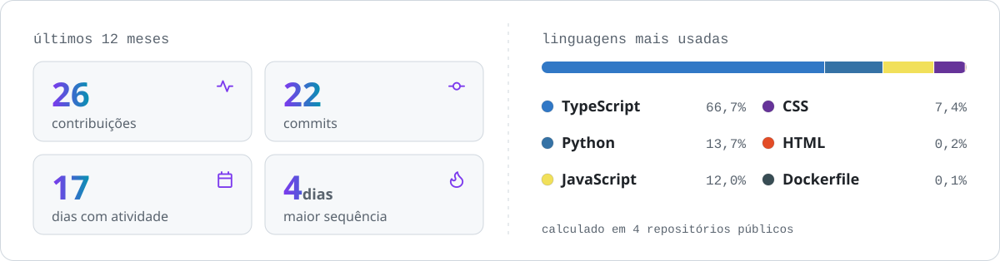

<a href="https://github.com/ggoncalves0">
  <picture>
    <source media="(prefers-color-scheme: dark)" srcset="assets/banner-dark.svg">
    
  </picture>
</a>

  <a href="mailto:ggoncalvesy03@gmail.com">
    <picture>
      <source media="(prefers-color-scheme: dark)" srcset="assets/badge-email-dark.svg">
      
    </picture>
  </a>
  <a href="https://www.linkedin.com/in/gabriel-goncalves-de-oliveira/">
    <picture>
      <source media="(prefers-color-scheme: dark)" srcset="assets/badge-linkedin-dark.svg">
      
    </picture>
  </a>

## Sobre mim

A tecnologia faz parte da minha vida desde muito novo, e a curiosidade de criança foi ganhando forma. Fiz o ensino técnico em TI e me formei em Análise e Desenvolvimento de Sistemas pela Impacta. Hoje programo em **Python**, **JavaScript** e **C#** e aprendo na prática: no meu [sistema de controle de estoque](https://github.com/ggoncalves0/inventory-management), desenvolvi da interface em **React** à API em **Flask**, com banco **MySQL**, login e controle de acesso por permissão. Sou proativo e disciplinado, gosto de resolver problemas e encaro cada projeto como uma chance de aprender algo novo.

- 🎯 Em busca de oportunidades como **desenvolvedor full stack júnior**
- 📍 Guarulhos, SP

## Tecnologias

<picture>
  <source media="(prefers-color-scheme: dark)" srcset="assets/stack-dark.svg">
  
</picture>

## Atividade no GitHub

<a href="https://github.com/ggoncalves0?tab=repositories">
  <picture>
    <source media="(prefers-color-scheme: dark)" srcset="assets/stats-dark.svg">
    
  </picture>
</a>
